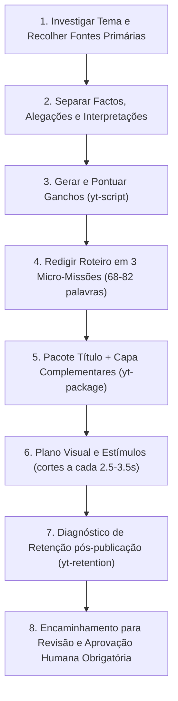

# futebol-invisivel-editorial

Esta competência governa a criação e avaliação editorial dos conteúdos do canal **Futebol Invisível** (`@FutebolInvisivelOficial`), garantindo que técnicas avançadas de engajamento do YouTube operem em total harmonia com a integridade factual e as travas de segurança do sistema.

> [!IMPORTANT]
> **Limites de Autoridade e Segurança Inegociáveis:**
> - Esta competência orienta e avalia roteiros e pacotes visuais; ela **NÃO pode** aprovar factos por conta própria, inventar fontes, fabricar assinaturas SHA-256 ou autorizar renderizações de vídeo sem a aprovação humana formal no Studio Web (`/api/editorial/aprovar`).
> - Nenhuma afirmação factual pode ser inventada ou inflada para aumentar a pontuação de um gancho.
> - O roteiro anterior sobre as alegadas planilhas paralelas do Manchester City **NÃO** deve ser utilizado como exemplo factual aprovado.

---

## 1. Fluxo Editorial em 8 Etapas do Futebol Invisível

Toda produção deve respeitar rigorosamente a seguinte sequência sequencial:

### Etapa 1: Investigar o Tema e Recolher Fontes Primárias
- Consultar fontes jornalísticas e documentos autênticos (relatórios da FIFA/UEFA, auditorias, despachos judiciais, declarações oficiais com gravação).
- Proibido recorrer a boatos vazios, fofocas de bastidores sem sustentação ou sensacionalismo calunioso.

### Etapa 2: Separar Factos Confirmados, Alegações e Interpretações
- **Factos Confirmados:** Dados com fontes documentais diretas e verificáveis.
- **Alegações de Terceiros:** Devem ser sempre atribuídas explicitamente (*"Segundo a denúncia do jornal X..."*, *"De acordo com a auditoria da UEFA..."*).
- **Interpretações/Opinião:** Devem ser contextualizadas como hipótese ou pergunta para o público, nunca apresentadas como verdade incontestável.

### Etapa 3: Gerar e Comparar Ganchos (`yt-script`)
- Utilizar os princípios de `yt-script` (`hookscore.py`) para eliminar rodeios, palavras vazias (*"basicamente"*, *"hoje vamos falar"*) e aberturas lentas.
- O gancho dos primeiros 3 segundos deve conter:
  1. Sujeito e cifra/data exata.
  2. Tensão real baseada em factos comprovados.
- **Atenção:** A pontuação do gancho no `hookscore.py` é um indicador de concisão e contraste, **nunca uma garantia de viralização**. Não adulterar dados reais para tentar inflar essa nota.

### Etapa 4: Produzir o Roteiro com as Três Micro-Missões
- **Extensão Obrigatória de Shorts:** Intervalo ideal de **68 a 82 palavras** (30 a 35 segundos de locução).
- **Estrutura das Micro-Missões:**
  - **Missão 1 (0–10s):** Confirmação imediata do gancho e revelação do conflito central.
  - **Missão 2 (10–22s):** O detalhe oculto ou a prova documental ignorada pela maioria, com micro-abertura (Open Loop).
  - **Missão 3 (22–32s):** A consequência concreta/impacto na temporada e fecho circular que conecta à primeira frase.
- **Evitar:** Perguntas dramáticas que nunca são respondidas, repetições da mesma frase e termos proibidos pelo motor (*"farsa"*, *"desmascarado"*, *"salário secreto"* sem fonte).

### Etapa 5: Rever Título e Capa como Conjunto Complementar (`yt-package`)
- Aplicar o princípio unitário do `yt-package` (`title.py`):
  - **O Título e a Capa NUNCA repetem as mesmas palavras.**
  - Se a Capa diz *"O SEGREDO DO PSG!"*, o Título deve focar no benefício/impacto factual: *"Ronaldinho e Mbappé: O detalhe que a imprensa não viu em 2024"*.
  - Limite do título: até 60 caracteres (desktop) e idealmente até 40–50 caracteres para não truncar em telas de smartphones.
  - Capa: Usar o padrão visual de alto contraste e cinema 8K com iluminação de estádio, acompanhado da tarja de urgência e tipografia Impact legível.

### Etapa 6: Preparar o Plano Visual e Pontos de Estímulo (Padrão de Renderização Dinâmica)
- **Motor de Renderização Nativo e Fluido:**
  - **FIM DEFINITIVO DOS SLIDES (100% VÍDEO EM MOVIMENTO EM DOCUMENTÁRIOS):**
    - Todo documentário longo (16:9) deve ser renderizado com **100% de vídeo real em movimento contínuo** (cortes a cada 3.2s a 3.8s).
    - Proibido usar sequência de fotos estáticas com Ken Burns como base do vídeo. O espectador rejeita a sensação de "slideshow / PowerPoint".
    - Fontes permitidas: lances de jogo blindados, discussões acaloradas com árbitros, coletivas oficiais de imprensa, filmagens aéreas de drone, treinos e túnel de vestiário.
    - Fotos/documentos entram apenas pontualmente como perícia forense (máximo 1 a cada 5 cortes), com zoom rápido pericial de 2.5s.
  - **REGRA DO ÁUDIO MESTRE ININTERRUPTO (ZERO CORTES / ZERO ENGASGOS):**
    - O áudio da narração NUNCA deve ser fatiado junto com os takes de vídeo. Fatiar áudio em cada corte de cena gera descontinuidade de pacotes AAC e micro-engasgos na reprodução.
    - O áudio mestre deve ser gerado como um fluxo unificado contínuo (`narracao_master_ininterrupta.wav`) do segundo 0 ao final do documentário.
    - Os takes de vídeo são renderizados mudos (`-an`) e o fluxo de áudio mestre é adicionado de forma contínua e limpa na multiplexação final.
  - **BLINDAGEM OBRIGATÓRIA ANTI-CONTENT ID / ANTI-COPYRIGHT:**
    - Transmissões oficiais de TV (LaLiga, Premier League, UEFA) possuem bots automáticos que identificam grafismos e câmeras de transmissão.
    - **Proibição de Grafismos de TV:** Proibido usar clipes contendo placares, vinhetas da liga (ex: `LIGA BBVA`), escalações táticas ou marcas d'água de emissoras.
    - **Quádrupla Blindagem em Takes de Jogo:**
      1. `hflip` (espelhamento horizontal para quebrar a busca vetorial do robô).
      2. `crop=in_w*0.82:in_h*0.82` (zoom perimetral de 18% para arrancar qualquer placar ou logo dos cantos).
      3. `eq=contrast=1.14:saturation=1.18` (alteração de curva de cores e histograma digital).
      4. Padronização estrita de codec: `fps=30`, `g=30` (GOP fixo), `pix_fmt=yuv420p`.
  - **FPS Contínuo:** Renderização estrita a 30 fps (proibido demux estático que cause efeito de tela travada a 1 fps).
  - **Transições Suaves:** Cortes inteligentes sem telas pretas e com continuidade narrativa.
  - **Legendas Dinâmicas em Linha Única Queimadas no Vídeo (ASS / Drawtext):** Legendas rápidas centralizadas na parte inferior, estritamente em **1 linha única**, trocando a cada 2 a 4 palavras no ritmo da fala (amarelo vibrante `#FFDE00`, contorno preto espesso de 6-8px e sombra suave), evitando acúmulo de texto longo.
  - **Marca d'Água Institucional Obrigatória:** Aplicação do selo circular oficial do canal (`perfil_futebol_invisivel.jpg`) com cantos arredondados e transparência suave no canto superior direito (`x=W-w-35:y=35`) em todos os vídeos e Shorts.
  - **Limpeza Visual e Anti-Stock:** Proibido o uso de fotos de bancos com marcas d'água (Alamy, Getty, Shutterstock) ou textos no fundo. Usar ilustrações ultra-realistas 8K geradas via Gemini totalmente limpas.
  - **Áudio e Trilha de Fundo Profissional:** Locução neural equalizada com trilha sonora orquestrada/cinematográfica contínua (`resource/songs/`) atenuada a volume de fundo (-18dB a -22dB / ganho 0.10 a 0.12), mantendo imersão de documentário sem abafar a voz.
- **Formatação de Telas e Dimensões:**
  - Super Documentários: Formato 16:9 Full HD (1920x1080) com 10 minutos ou mais de densidade investigativa e divisão capitulada.
  - Shorts: Formato 9:16 vertical (1080x1920) com ritmo dinâmico de 30 a 45 segundos.
  - **Empacotamento Triplo Obrigatório (A/B/C):** Todo documentário deve ter 3 capas 16:9 de alto CTR geradas e 1 capa vertical 9:16 para o Short correspondente.
- **Fuso Horário e Agendamento para Cabo Verde (UTC-1):**
  - Toda conversão de horário para publicação deve respeitar a localização de Cabo Verde e direcionar os picos de público no Brasil (UTC-3 / -2h) e Portugal (UTC+1 / +2h).
- **Tags e Otimização para YouTube Studio:**
  - O bloco de tags deve ser preenchido de forma calibrada até o limite exato permitido pelo YouTube (480 a 498 caracteres de 500), combinando os maiores canais de futebol do ecossistema com os termos de maior volume de busca sobre o tema.
- **Proibição Absoluta:**
  - Vídeos com marcas d'água de bancos de imagens, trechos de outros canais com logos ou legendas queimadas em inglês. Imagens devem ser limpas e cinematográficas.

### Etapa 7: Diagnóstico de Retenção Real (`yt-retention`)
- Quando os dados de retenção do YouTube Studio estiverem disponíveis (export CSV da retenção do vídeo), utilizar `retention.py` para mapear:
  - **Hook Leak (Queda nos primeiros 30s):** O gancho foi lento ou disperso?
  - **Cliffs (Quedas abruptas):** Em que segundo específico o público abandonou o vídeo? O que estava sendo narrado ou exibido?
  - **Slide (Taxa de escape contínuo):** Houve monotonia no ritmo ou falta de novas micro-missões?
- Retroalimentar as regras da próxima produção com os aprendizados obtidos.

### Etapa 8: Encaminhamento Obrigatório para Aprovação Humana
- Toda minuta gerada é salva como `PENDENTE DE REVISÃO`.
- O editor humano deve revisar na interface do Studio Web (`http://127.0.0.1:8505`):
  - Roteiro integral, contagem de palavras e divisão por missões.
  - Afirmações factuais e fontes anexadas.
  - Conjunto de título e capa.
- A renderização **SÓ** é autorizada após a emissão da assinatura formal SHA-256 no endpoint `/api/editorial/aprovar`.
